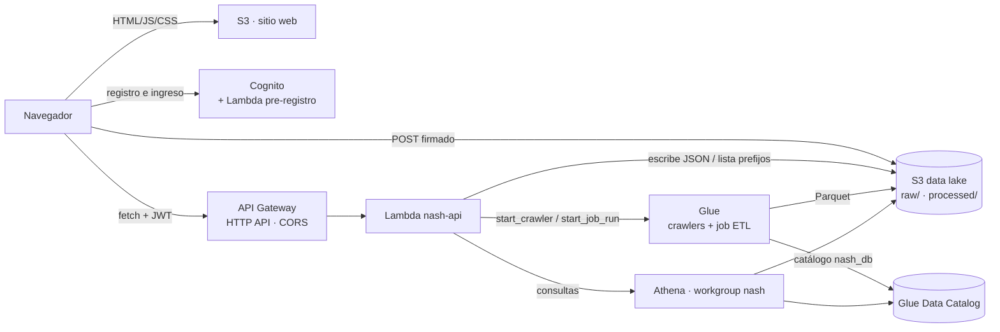

# Proyecto final · Computación en la Nube 2026-2

Todo lo del curso vive aquí, no en el sitio. La página web solo habla de NASH: el banco de parciales,
quices, apuntes y talleres de **todas las carreras** del Rosario.

- [1. Qué hace la aplicación](#1-qué-hace-la-aplicación)
- [2. Cómo cumple el enunciado](#2-cómo-cumple-el-enunciado)
- [3. Arquitectura](#3-arquitectura)
- [4. Entregas](#4-entregas)
- [5. Conectar la base de datos (empezar a probar con datos reales)](#5-conectar-la-base-de-datos)
- [6. Consultar en Athena](#6-consultar-en-athena)
- [7. Estructura del repositorio](#7-estructura-del-repositorio)
- [8. Créditos](#8-créditos)

---

## 1. Qué hace la aplicación

Un estudiante con correo `@urosario.edu.co` crea su cuenta, elige su carrera y sube un parcial, un quiz,
un taller o sus apuntes de una materia. Los demás lo encuentran por carrera, materia, tipo y periodo, y lo
descargan.

- **24 carreras.** Las que tienen el pensum cargado (hoy MACC) muestran sus materias por semestre. En las
  demás, la materia se crea cuando alguien sube el primer archivo y escribe su nombre. Las 5 materias del
  núcleo rosarista son de todas las carreras.
- **Restricción dinámica:** el mismo parcial (misma materia, tipo, periodo, número y profesor) no entra
  dos veces. En los apuntes cuenta el autor en lugar del profesor.

## 2. Cómo cumple el enunciado

| Requisito del enunciado | Dónde está |
| --- | --- |
| Frontend en **S3 Static Website Hosting** | `WebBucket` en [backend/template.yaml](backend/template.yaml); contenido en [frontend/](frontend/) |
| **API Gateway** recibe las peticiones | `HttpApi` (HTTP API, 8 rutas) con autorizador JWT de Cognito |
| **Lambda** escribe en S3 (zona raw) | [backend/src/api/app.py](backend/src/api/app.py) → `raw/materiales/`, `raw/descargas/`, `raw/archivos/` |
| Lambda dispara **Glue** / consulta **Athena** | La primera subida arranca el crawler raw; cada confirmación arranca el job ETL; las listas y estadísticas salen de Athena |
| **Data lake** Raw / Processed | `raw/` en JSON, `processed/` en Parquet particionado por `periodo` |
| **Glue**: catálogo + ETL a Parquet | 2 crawlers (raw y processed) y el job [backend/glue/etl_materiales.py](backend/glue/etl_materiales.py) |
| **Athena** | Grupo de trabajo `nash`; consultas en [backend/athena/consultas.sql](backend/athena/consultas.sql) |
| 1. Despliegue web con URL de S3 | Salida `WebsiteURL` de la pila |
| 2. `fetch` hacia API Gateway | [frontend/js/api.js](frontend/js/api.js) (JSON) y subida del archivo con POST firmado a S3 |
| 3. **CORS** en API Gateway | `CorsConfiguration` del `HttpApi`: permite `WebsiteURL` y `http://localhost:8765` |
| 4. Lambda escribe en S3 y dispara Glue / Athena | Ver arriba |
| Campo de **texto** | Título, profesor, nombre de la materia |
| Campo **numérico** | Número del parcial / quiz / taller / semana |
| Campo de **fecha** | Fecha en que se presentó (de ahí sale el periodo `2026-1`) |
| **Restricción dinámica** | `GET /materiales/disponibilidad`: la Lambda **lista objetos en S3** con el prefijo `raw/materiales/<materia>__<tipo>__<periodo>__` y devuelve los números ocupados. El formulario los bloquea en vivo y `POST /materiales` responde **409** si se intenta igual |

La clave de unicidad va en el nombre del objeto, así que basta con listar un prefijo:

```
raw/materiales/macc.31__parcial__2026-1__n2__andres-vargas__<material_id>.json
raw/materiales/economia.microeconomia-i__quiz__2026-2__n1__laura-perez__<material_id>.json
```

## 3. Arquitectura



Detalle completo (roles, permisos, formatos y esquemas): [docs/entrega-1.md](docs/entrega-1.md).

| Zona | Prefijo | Formato |
| --- | --- | --- |
| Raw | `raw/materiales/`, `raw/descargas/` | JSON de una línea |
| Raw | `raw/archivos/` | PDF, JPG o PNG |
| Processed | `processed/materiales/periodo=…/` | Parquet (Snappy) |
| Resultados | `athena-resultados/` | CSV (lo escribe Athena) |

## 4. Entregas

| Entrega | Fecha | Contenido | Dónde |
| --- | --- | --- | --- |
| **1** | 6 nov | Grupo, descripción, diagrama end-to-end, permisos IAM, formatos | [docs/entrega-1.md](docs/entrega-1.md), [docs/iam/](docs/iam/) · **falta llenar los nombres del grupo** |
| **2** | 13 nov | Código Lambda | [backend/src/](backend/src/) |
| | | API Gateway con endpoints y CORS | `HttpApi` en [backend/template.yaml](backend/template.yaml) |
| | | Crawlers | `RawCrawler` y `ProcessedCrawler` en la plantilla |
| | | Diseño del frontend en HTML/JS | [frontend/](frontend/) |
| **Final** | a convenir | Exposición, diagrama final, demo en vivo con datos reales, consulta en Athena | Secciones 3, 5 y 6 de este documento |

> Todos los integrantes deben subir las entregas 1 y 2 al aula. Quien no lo haga queda con 0.

## 5. Conectar la base de datos

NASH no usa una base de datos tradicional: la "base de datos" es el **data lake en S3**, catalogado por
**Glue** y consultado con **Athena**. Las cuentas viven en **Cognito**. Todo se crea con una sola
plantilla de SAM.

Mientras `frontend/js/config.js` esté vacío, el sitio corre en **modo local**: el banco empieza vacío y lo
que subas queda solo en tu navegador. Para tener datos reales:

### 5.1 Una vez por computador

1. Instala [AWS CLI v2](https://docs.aws.amazon.com/cli/latest/userguide/getting-started-install.html),
   [AWS SAM CLI](https://docs.aws.amazon.com/serverless-application-model/latest/developerguide/install-sam-cli.html)
   y Python 3.12.
2. Pon las credenciales:
   - **AWS Academy (Learner Lab):** *Start Lab* → *AWS Details* → *AWS CLI: Show*, y copia el bloque
     en `%USERPROFILE%\.aws\credentials` (Windows) o `~/.aws/credentials`. Se vencen cada sesión del
     laboratorio: hay que volver a copiarlas.
   - **Cuenta propia:** `aws configure`.
3. Comprueba: `aws sts get-caller-identity` debe mostrar la cuenta correcta.

### 5.2 Crear el backend (una persona del grupo, una vez)

```bash
cd backend
sam build
sam deploy --guided
```

| Pregunta | Respuesta |
| --- | --- |
| Stack Name | `nash` |
| AWS Region | `us-east-1` |
| Prefijo | `nash` |
| LabRoleArn | Learner Lab: `arn:aws:iam::<id de la cuenta>:role/LabRole` · cuenta propia: vacío |
| DominiosPermitidos | `urosario.edu.co` |
| MaxMB | `10` |
| OrigenLocal | `http://localhost:8765` |
| Las demás | `y` |

El ID de la cuenta sale en `aws sts get-caller-identity` (campo `Account`). Al terminar, SAM imprime las
**Outputs**; también están en CloudFormation → `nash` → Outputs.

Luego sube el script del job ETL:

```bash
aws s3 cp glue/etl_materiales.py s3://<DataBucketName>/scripts/etl_materiales.py
```

### 5.3 Conectar el frontend

Copia las salidas en [frontend/js/config.js](frontend/js/config.js):

```js
window.NASH_CONFIG = {
  API_URL: "<ApiUrl>",                    // https://xxxx.execute-api.us-east-1.amazonaws.com
  REGION: "us-east-1",
  COGNITO_USER_POOL_ID: "<UserPoolId>",
  COGNITO_CLIENT_ID: "<UserPoolClientId>",
  DOMINIOS_PERMITIDOS: ["urosario.edu.co"],
  MAX_MB: 10
};
```

Con `API_URL` y `COGNITO_CLIENT_ID` llenos, el modo local se apaga solo.

### 5.4 Probar con datos reales desde tu computador

No hace falta subir el sitio a S3 para empezar: la API ya acepta `http://localhost:8765` por CORS.

```bash
cd frontend
python -m http.server 8765
```

Abre <http://localhost:8765> (tiene que ser ese puerto exacto) y:

1. **Crea una cuenta** con tu correo `@urosario.edu.co`. Cognito manda un código (revisa el correo no
   deseado; el remitente por defecto aguanta unos 50 correos al día).
2. **Sube un parcial.** En S3 → `<DataBucketName>` aparecen `raw/materiales/…json`,
   `raw/archivos/<id>.pdf` e `indice/<id>.json`.
3. **Intenta subir el mismo parcial otra vez:** el formulario lo bloquea y la API responde 409.
4. Espera 1 o 2 minutos a que el **crawler raw** cree la tabla `raw_materiales` (Glue → Crawlers). Desde
   ahí la lista de la materia y los conteos de la portada salen de Athena.
5. El **job ETL** corre después de cada subida confirmada (unos 2 minutos) y lanza el **crawler
   processed**, que crea `proc_materiales`. Entonces se llena **Estadísticas**.

Cada integrante puede probar así con la misma pila: solo necesita el mismo `config.js`.

### 5.5 Publicar el sitio (para la demo)

```bash
# desde la raíz del repositorio
aws s3 sync frontend/ s3://<WebBucketName>/ --delete
```

Abre `<WebsiteURL>`. Esa es la URL de S3 que pide el enunciado.

### 5.6 Si algo falla

| Síntoma | Qué pasa |
| --- | --- |
| "No hay conexión con la API" / error de CORS | El sitio no se abrió desde `WebsiteURL` ni desde `http://localhost:8765` (otro puerto también falla). |
| `WebBucketPolicy` falla con *BlockPublicPolicy* | S3 → *Block Public Access settings for this account* → desactivar, y volver a desplegar. |
| Las listas salen vacías justo después de la primera subida | El crawler raw todavía no termina. |
| Estadísticas en cero | El job ETL no ha corrido, o falta `scripts/etl_materiales.py` en el bucket. |
| En Learner Lab todo deja de responder | Venció la sesión del laboratorio: inícialo otra vez y actualiza las credenciales. |

Más detalle en [docs/despliegue.md](docs/despliegue.md). Para borrar todo al final:

```bash
aws s3 rm s3://<WebBucketName> --recursive
aws s3 rm s3://<DataBucketName> --recursive
sam delete --stack-name nash
```

## 6. Consultar en Athena

Consola de Athena → grupo de trabajo **nash** → base `nash_db`. Las consultas para la demo están en
[backend/athena/consultas.sql](backend/athena/consultas.sql). Por ejemplo:

```sql
-- material por carrera y tipo
SELECT carrera_id, tipo, count(*) AS archivos
FROM proc_materiales
GROUP BY carrera_id, tipo
ORDER BY archivos DESC;
```

## 7. Estructura del repositorio

```
frontend/                 sitio estático (va al bucket del sitio)
  index.html              portada: carreras, el banco hoy, cómo funciona, preguntas
  ingresar.html           crear cuenta, confirmar código, ingresar, recuperar contraseña
  app.html                la app: inicio, explorar, materia, subir, mis aportes, estadísticas
  js/config.js            ← aquí van las salidas de la pila
  js/pensum.js            carreras, pensums cargados y núcleo rosarista
  js/auth.js              Cognito por fetch (o cuentas locales sin config)
  js/api.js               cliente de la API (o banco local sin config)
backend/
  template.yaml           SAM: buckets, Cognito, HTTP API, Lambdas, Glue, Athena, IAM
  src/api/app.py          Lambda nash-api (8 rutas)
  src/api/pensum.py       las mismas carreras y pensums, en Python
  src/presignup/app.py    Lambda de pre-registro (solo @urosario.edu.co)
  glue/etl_materiales.py  job ETL: JSON → Parquet particionado por periodo
  athena/consultas.sql    consultas de la API y de la demo
docs/
  entrega-1.md            grupo, descripción, arquitectura, IAM, formatos
  despliegue.md           despliegue paso a paso
  iam/                    políticas de los integrantes
```

## 8. Créditos

- Tipografías: Gambarino y General Sans, de [Fontshare](https://www.fontshare.com) (ITF Free Font License).
- Fotografías (en escala de grises), de Wikimedia Commons salvo la última:
  - "Claustro de la Universidad de Nuestra Señora del Rosario", AndresJaramillo1992, CC BY-SA 3.0.
  - "Claustro del Colegio Mayor de Nuestra Señora del Rosario (Bogotá) 01", Racso (Oscar Fernando
    Gómez), CC BY-SA 3.0 (en la pantalla de ingreso).
  - "CMAP", Jérémy Barande, CC BY-SA 3.0.
  - "Entrada Capilla Universidad del Rosario", Julio Racines (1886), dominio público.
  - "Sampler with compound division equation", Mary Ann Sadler, The Met, dominio público.

Proyecto académico. NASH no es un sitio oficial de la Universidad del Rosario.
