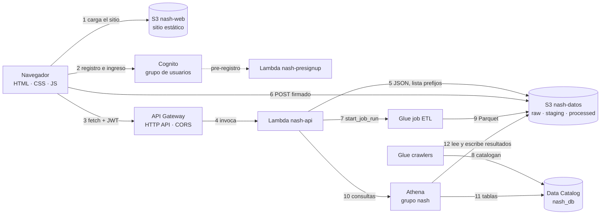

# NASH: Entrega 1

**Computación en la Nube 2026-2 · Proyecto final · MACC, Universidad del Rosario**

## 1. Grupo

| Integrante | Correo | Rol en el proyecto |
| --- | --- | --- |
| _(nombre)_ | _(correo)_@urosario.edu.co | Infraestructura (SAM, IAM, despliegue) |
| _(nombre)_ | _(correo)_@urosario.edu.co | Backend (Lambda, API Gateway) |
| _(nombre)_ | _(correo)_@urosario.edu.co | Datos (Glue, Athena) |
| _(nombre)_ | _(correo)_@urosario.edu.co | Frontend (HTML, CSS, JS) |

## 2. La aplicación

**NASH** es un banco de parciales, quices, apuntes y talleres de las materias de MACC. Los suben los
estudiantes que ya vieron la materia. Cada archivo queda en su materia del pensum con el profesor, el
periodo y el nombre de quien lo subió. Para entrar hace falta una cuenta con correo @urosario.edu.co.

Qué se puede hacer:

- **Crear una cuenta e ingresar.** Cognito maneja el registro, el código de confirmación por correo y la
  recuperación de la contraseña.
- **Ver el pensum como mapa.** Son 8 semestres con 33 materias de MACC y 5 del núcleo rosarista. Cada
  materia muestra cuánto material tiene. Al elegir una se marcan sus prerrequisitos y las materias que abre.
- **Abrir una materia.** Muestra su material con filtros de tipo, periodo, profesor y texto, quién lo subió
  y la descarga.
- **Subir material**, con la restricción dinámica descrita abajo.
- **Ver mis aportes y las estadísticas.** Las estadísticas son consultas de Athena sobre el Parquet.

### Campos del formulario de subida

| Campo | Tipo | Regla |
| --- | --- | --- |
| Materia | texto (lista) | Una de las 38 del pensum |
| Tipo | texto (lista) | apuntes, parcial, quiz, ejercicios |
| **Título** | **texto** | 4 a 90 caracteres |
| Profesor | texto | 3 a 60 letras |
| **Número** | **numérico** | Parcial, quiz o taller: 1 a 20. Apuntes: semana 1 a 18 |
| **Fecha en que se presentó** | **fecha** | Entre 2015-01-01 y hoy. De ella sale el periodo (enero a junio = -1) |
| Con solución | booleano | No aplica a apuntes |
| Descripción | texto | Opcional, hasta 400 caracteres |
| Archivo | PDF, JPG o PNG | Hasta 10 MB |

### Restricción dinámica

**No se puede subir dos veces el mismo material.** La clave es:

- para parciales, quices y talleres: materia + tipo + periodo + número + profesor;
- para apuntes: materia + tipo + periodo + semana + autor, porque los apuntes son de quien los toma.

La clave va en el nombre del objeto en S3:

```
raw/materiales/macc.31__parcial__2026-1__n2__andres-vargas__9f1c…e2.json
```

Para revisarla, la Lambda **lista el prefijo en S3** (`ListObjectsV2`), sin base de datos ni Athena:

1. Mientras el estudiante llena el formulario, `GET /materiales/disponibilidad` lista
   `raw/materiales/macc.31__parcial__2026-1__` y devuelve los números ocupados. El formulario muestra
   "Parcial 1, Parcial 2 ya en el banco · Siguiente libre: 3".
2. Si el número elegido ya existe, el formulario dice quién lo subió y cuándo, y bloquea el envío.
3. `POST /materiales` vuelve a revisar y responde **409** si hay duplicado.
4. `POST /materiales/{id}/confirmar` revisa una última vez antes de escribir. Así, si dos personas suben
   lo mismo a la vez, solo entra una.

El nombre del profesor se normaliza antes de comparar: sin tildes, sin "Prof." y en minúsculas. Así,
"Andrés Vargas" y "prof. andres vargas" chocan.

## 3. Arquitectura

El diagrama completo, del navegador a Athena, está en **`frontend/arquitectura.html`**. También se ve
desde el pie de la página de inicio ("Arquitectura en AWS").



| Servicio | Recurso | Para qué |
| --- | --- | --- |
| S3 | `nash-web-<cuenta>` | Sitio estático (alojamiento de sitio web, lectura pública) |
| S3 | `nash-datos-<cuenta>` | Data lake privado: `raw/`, `staging/`, `processed/`, `athena-resultados/`, `scripts/` |
| Cognito | `nash-usuarios` | Cuentas, confirmación por correo, JWT |
| Lambda | `nash-presignup` | Solo deja registrar correos @urosario.edu.co |
| API Gateway | HTTP API | 8 rutas con autorizador JWT y CORS del dominio del sitio |
| Lambda | `nash-api` | Validación, restricción dinámica, URLs firmadas, Athena, inicio de Glue |
| Glue | `nash_db`, `nash-crawler-raw`, `nash-crawler-processed` | Catálogo de `raw_*` y `proc_*` |
| Glue | `nash-etl-materiales` | JSON → Parquet particionado por periodo |
| Athena | grupo `nash` (motor v3) | Listas, conteos y estadísticas |

## 4. Permisos (IAM)

### Integrantes del grupo

| Perfil | Quién | Política | Qué permite |
| --- | --- | --- | --- |
| Desarrollo | Infraestructura y backend | [`docs/iam/integrante-desarrollo.json`](iam/integrante-desarrollo.json) | Desplegar y borrar la pila (CloudFormation), y administrar sus recursos `nash-*`: S3, Lambda, API Gateway, Cognito, Glue y Athena. `iam:PassRole` solo sobre los roles `nash-*`. Ver logs. |
| Consulta | Datos y frontend | [`docs/iam/integrante-consulta.json`](iam/integrante-consulta.json) | Consultas en el grupo de Athena `nash`, lectura del catálogo `nash_db` y del lago, escritura solo en `athena-resultados/`, iniciar los crawlers y el job. No puede borrar nada del lago de datos; sí puede publicar el sitio en `nash-web`. |

Nadie del grupo usa la cuenta raíz. Cada integrante tiene su usuario y su MFA.

En **AWS Academy (Learner Lab)** no se pueden crear usuarios ni roles. Allí todos entran con la sesión
del laboratorio y la pila usa `LabRole` (parámetro `LabRoleArn`). Las políticas de esta sección
documentan el diseño de permisos mínimos y se aplican tal cual en una cuenta normal.

### Roles de la aplicación

Los define `backend/template.yaml`. Se crean solo si `LabRoleArn` está vacío.

| Rol | Lo asume | Permisos |
| --- | --- | --- |
| `nash-api-rol` | Lambda `nash-api` | **S3:** Get, Put y Delete en `raw/*`, `staging/*`, `indice/*` y `athena-resultados/*`. Get en `processed/*`. List en el bucket de datos. **Athena:** Start, Get y Stop de consultas en el grupo `nash`. **Glue:** leer `nash_db` y sus tablas; `StartJobRun` del ETL y `StartCrawler` del crawler raw. **CloudWatch Logs.** |
| `nash-presignup-rol` | Lambda `nash-presignup` | Solo CloudWatch Logs |
| `nash-glue-rol` | Crawlers y job de Glue | `AWSGlueServiceRole`. **S3:** Get en `raw/*` y `scripts/*`; Get, Put y Delete en `processed/*` y `glue-temporal/*`; List del bucket. **Glue:** `StartCrawler` del crawler processed. |
| _(política de bucket)_ | Público | Solo `s3:GetObject` en `nash-web`. El bucket de datos bloquea todo acceso público; los archivos se suben y bajan con URLs firmadas que vencen en 10 y 5 minutos. |

## 5. Formatos de datos

| Zona | Prefijo | Formato | Ejemplo / esquema |
| --- | --- | --- | --- |
| Raw | `raw/materiales/` | **JSON** de una línea, un objeto por material | Abajo |
| Raw | `raw/descargas/` | **JSON** de una línea, un objeto por descarga | `{"descarga_id":"…","material_id":"…","materia_id":"macc.31","usuario_id":"<sub>","creado_en":"2026-11-04T15:02:11Z"}` |
| Raw | `raw/archivos/` | PDF, JPG o PNG | `raw/archivos/<material_id>.pdf` |
| Staging | `staging/` | JSON pendiente hasta confirmar la subida; expira en 1 día | Igual al registro, más `archivo_key` |
| Processed | `processed/materiales/periodo=2026-1/` | **Parquet** (Snappy), partición `periodo` | Abajo |
| Resultados | `athena-resultados/` | **CSV** que escribe Athena; expira en 7 días | |

Registro en `raw/materiales/` (una línea; aquí con saltos para leerlo):

```json
{
  "material_id": "9f1c3b0e6a2d4c55b1e0a7d3c8f4e2a1",
  "carrera_id": "macc", "materia_id": "macc.31", "materia_nombre": "Cálculo 2", "tipo": "parcial", "numero": 2,
  "titulo": "Integrales impropias y series",
  "profesor": "Andrés Vargas", "profesor_slug": "andres-vargas",
  "fecha": "2026-04-17", "periodo": "2026-1", "con_solucion": false,
  "descripcion": "",
  "archivo_nombre": "parcial-2-calculo-2.pdf", "archivo_tipo": "application/pdf", "archivo_bytes": 2467840,
  "autor_id": "<sub de Cognito>", "autor_nombre": "Santiago Herrera",
  "creado_en": "2026-04-25T21:40:00Z"
}
```

Tabla `proc_materiales` (Parquet, la escribe el job ETL):

| Columna | Tipo | Columna | Tipo |
| --- | --- | --- | --- |
| material_id | string | con_solucion | boolean |
| materia_id | string | descripcion | string |
| semestre | int (del pensum) | archivo_nombre / archivo_tipo | string |
| tipo | string | archivo_bytes | bigint |
| numero | int | archivo_kb | int |
| titulo | string | autor_id / autor_nombre | string |
| profesor / profesor_slug | string | creado_en | timestamp |
| fecha | date | descargas | bigint (suma de raw_descargas) |
| periodo | string, **partición** | ultima_descarga | timestamp |

## 6. Lo que sigue

- **Entrega 2 (13 de noviembre):** código de las Lambdas (`backend/src/`), rutas de API Gateway con CORS y
  crawlers (`backend/template.yaml`), y el frontend en HTML/JS (`frontend/`). Hoy el frontend funciona
  en modo demostración sin la nube.
- **Final:** despliegue según `docs/despliegue.md`, datos reales de compañeros y las consultas de
  `backend/athena/consultas.sql` en vivo.
